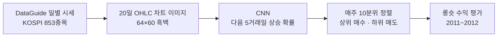
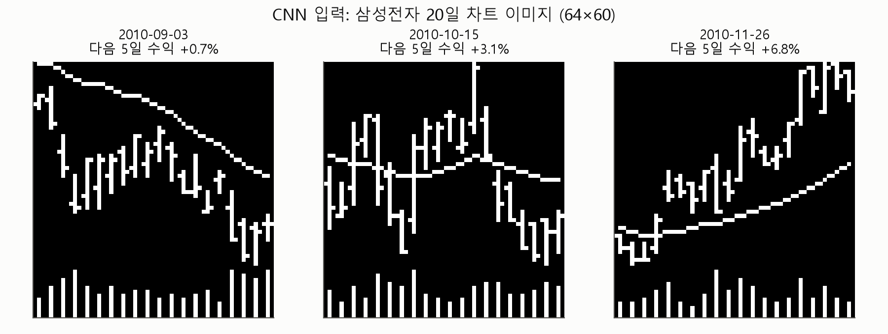
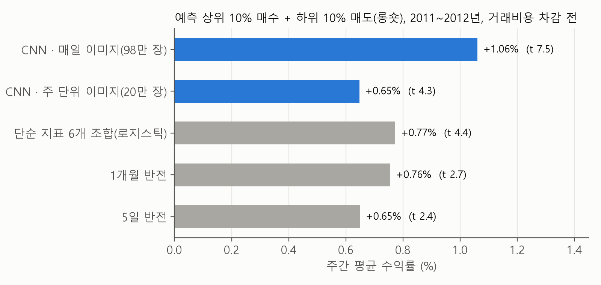
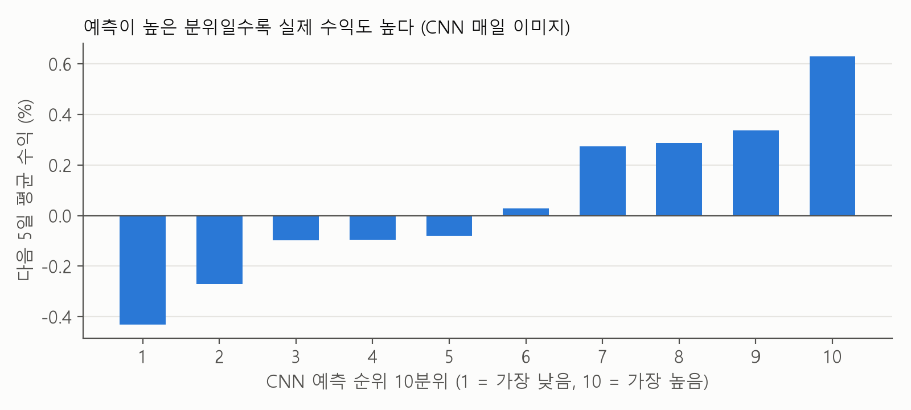
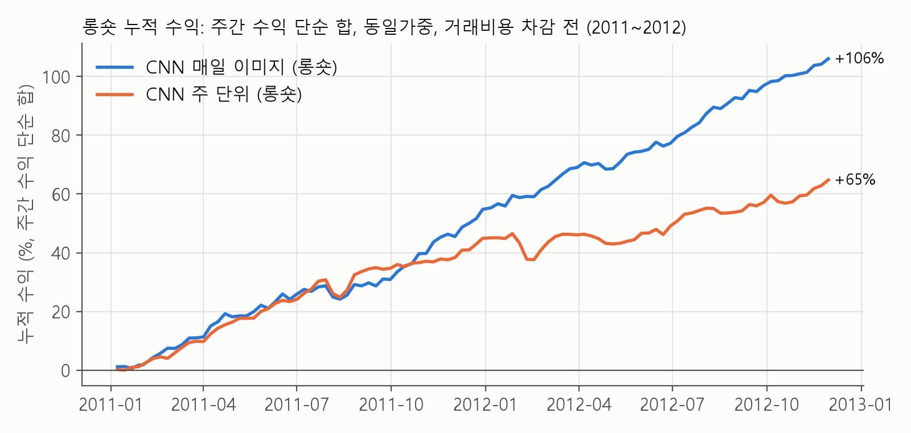
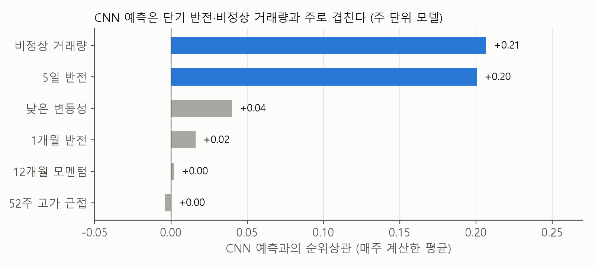

# 차트 딥러닝 알파의 결정 요인과 실현 가능성

A조 중간 공유 · 2026년 10월

기획안: [[[26-2 페이퍼스 2주차] A조_차트 딥러닝 알파의 결정 요인과 실현 가능성]]

---

## 연구 질문

**핵심 질문**: 한국 주식시장에서 차트 CNN의 수익은 어디서 나오고 거래 제약을 반영하면 얼마나 남는가

**주가설**: 차트 CNN 수익의 상당 부분은 개인 투자자의 매수 압력이 만든 일시적 가격 왜곡에서 나온다

| RQ | 질문 | 진행 |
|---|---|---|
| RQ1 성과 재현 | 차트 CNN 롱숏 성과가 가중 방식·체결 시점·초소형주 포함 여부에 따라 얼마나 달라지는가 | 기준 성과 확인 |
| RQ2 수익 경로 | CNN 매수 신호 종목을 개인이 따라 사고, 이후 수익률이 반전되는가 | 개인 순매수 자료 확보 중 |
| RQ3 수익의 성격 | 그 수익은 가격 압력·유동성 공급·정보·위험 보상 가운데 무엇인가 | 미착수 |
| RQ4 실현 가능성 | 공매도 제약·상하한가·거래비용 반영 후 CNN 수익은 얼마나 남는가 | 미착수 |
| RQ5 모델 구조 | CNN이 보는 차트 구간과 모델 구조에 따라 수익이 달라지는가 | 예비 분석 |

> 말할 것: 오늘은 RQ1 기준 성과와 RQ5 예비 결과를 보고하고, RQ2로 넘어가는 근거를 말씀드리겠습니다.

---

## 1차 발표 피드백과 대응

1. **핵심 논문 정독** → 핵심 선행연구 3편 선정·요약, 다음 회의까지 정독
2. **실현 가능성** → 데이터 구축부터 CNN 학습, 롱숏 평가까지 파일럿으로 전 과정 구현

---

## 핵심 선행연구 3편

| 논문 | 핵심 내용 | 우리 연구와의 관계 |
|---|---|---|
| Jiang·Kelly·Xiu (2023, *JF*) | 가격 차트를 이미지로 그려 CNN에 넣으면 모멘텀·단기 반전보다 수익률 예측력이 높음 | 이미지 규격·CNN 구조의 기준 |
| Jeong·Byun·Kim (2026, *RIBAF*) | 같은 방법을 한국에 적용, 20일 이미지·5일 예측 동일가중 샤프 5.48(비용 전). 개인·외국인이 CNN 상위 종목을 단기 순매수. 30bp 비용이면 주간 전략 수익 소멸 | 가장 가까운 선행연구. 매수 이후 반전은 미검정 → RQ2 |
| Guan·Li·Si (2026, SSRN) | CNN은 이동평균선·거래량보다 최근 며칠의 가격 막대를 보고 판단 | CNN이 보는 구간 분석(RQ5) |

---

## 방법: 차트 이미지 → CNN → 롱숏 포트폴리오

- 하루 = 3픽셀 막대(왼쪽 시가, 가운데 고가~저가, 오른쪽 종가), 선 = 20일 이동평균, 아래 = 거래량
- CNN: Jiang·Kelly·Xiu와 같은 합성곱 3층 구조, 이미지만 보고 다음 5거래일 상승 확률 출력
- 롱숏: 매주 CNN 확률 상위 10% 매수, 하위 10% 매도를 가정한 수익

---

## 실험 설계

| 항목 | 내용 |
|---|---|
| 데이터 | DataGuide KOSPI 일별 시세, 상장폐지 종목 포함(생존편향 방지) |
| 표본 | 2004~2012년 거래 보통주 853종목 |
| 학습 이미지 | 주 단위 형성 20.5만 장 / 매일 형성 97.8만 장 |
| 라벨 | 다음 5거래일 수익률 > 0 (형성일 종가 기준, 체결 비용 미반영) |
| 학습 / 평가 | 2005.01~2010.11 / 2011.01~2012.11 (100주, 71,222개) |
| 검증 | 학습 구간 내 무작위 30%, 일부 설정은 2010년 시간 블록 |
| 비교 기준 | 같은 표본의 단순 지표 6개(단기 반전·1개월 반전·52주 고가·비정상 거래량·변동성·모멘텀) 로지스틱 회귀 |

- 설정 8개(형성 주기·학습률·검증 방식·거래량 제거·20일 라벨)를 Kaggle GPU에서 학습, 결과 전부 보고
- 2011~2012년은 설정을 비교한 탐색 구간. 최종 시험 구간(2015년 이후)은 미사용

---

## 결과 ① CNN vs 단순 지표

- 매일 형성 이미지로 학습한 CNN: 롱숏 주간 +1.06% (t 7.5, 샤프 5.41)
- 단순 지표 6개 로지스틱: +0.77% (t 4.4)
- 2010년 시간 블록으로 검증한 CNN: 매일 형성 +0.88%, 주 단위 +0.30%
- 매일 형성이 주 단위보다 일관되게 높음(+0.72~1.06% vs +0.30~0.65%). 데이터 양 때문인지 라벨 중복 때문인지는 미구분. 시드 1개, 차이 검정 전

> 말할 것: t값은 평균 수익이 0과 구별되는 정도이고, 2를 넘으면 우연으로 보기 어렵습니다. 모두 거래비용 차감 전입니다.

---

## 결과 ② 10분위 수익과 누적 수익

- 1분위 −0.43% → 10분위 +0.63%, CNN 확률 순위에 따라 다음 5일 수익이 대체로 단조 증가
- 누적 수익은 동일가중 롱숏의 비용 전 주간 수익 단순 합. 실현 가능 수익 아님
- 롱숏 수익의 약 40%가 숏 쪽(1분위)에서 발생. 평가 구간에 공매도 금지 기간(2011.8~11)이 포함돼 RQ4에서 반영

---

## 결과 ③ CNN이 학습한 패턴

- 주 단위 CNN 확률은 비정상 거래량(+0.21), 5일 단기 반전(+0.20)과 약한 양의 순위상관
- 즉 CNN은 최근 하락했고 거래가 급증한 종목을 상위로 고르는 경향. 다만 상관이 약해 두 지표로 전부 설명되지는 않음
- 거래량 막대를 지운 CNN도 +0.72%로, 거래량 정보의 역할은 불분명
- **RQ2로 이어지는 이유**: 단기 반전은 흔히 일시적인 매매 압력이 되돌아가는 현상으로 해석. 그 압력이 개인 매매에서 오는지, 매수와 매도 중 어느 쪽인지를 투자자별 순매수로 검정(RQ2·RQ3)

---

## 한계

- 학습 시드 1개
- 평가 구간 100주(2011.01~2012.11), 다음 5일 수익이 플러스인 종목·주 비율 45%
- 거래비용·공매도 제약·상하한가 미반영, 매주 종목 교체 전략이라 비용 차감 시 크게 감소 가능
- KOSPI만 분석, 개인·외국인 매매(RQ2·RQ3) 미분석
- 20일 예측은 유의한 수익 없음(t −0.4)

---

## 다음 할 일

1. 핵심 선행연구 3편 정독 (각자)
2. DataGuide 투자자별 순매수(개인·외국인·기관) 일별 자료 확보 → **RQ2·RQ3: 개인 매수 뒤 반전 검정**
3. CNN 확률을 단기 반전·거래량에 직교화한 잔여 수익, 가중 방식·체결 시점·초소형주 변형 → RQ1·RQ5
4. 거래비용·가격제한폭·공매도 제약 반영 → RQ4
5. 시드 반복, 최근 5일 마스킹 재학습 → RQ5

> 말할 것: 2번 자료를 나눠 받으면 핵심인 RQ2를 바로 시작할 수 있습니다.

---

## 부록: 용어

| 용어 | 뜻 |
|---|---|
| CNN | 이미지에서 패턴을 학습하는 딥러닝 모델(합성곱 신경망) |
| 10분위 | 매주 CNN 확률 순서로 종목을 10개 묶음으로 나눈 것 |
| 롱숏 | 상위 10% 매수·하위 10% 매도를 가정한 수익(상위 수익 − 하위 수익) |
| t값 | 평균 수익이 0과 구별되는 정도, 대략 2 이상이면 우연으로 보기 어려움 |
| 샤프 비율 | 변동성 대비 수익, 연율 환산 |
| 단기 반전 | 최근 크게 하락한 종목이 단기간 반등하는 현상 |
| 비정상 거래량 | 최근 5일 거래대금 ÷ 직전 60일 평균 |
| 직교화 | 다른 지표로 설명되는 부분을 빼고 남는 부분만 보는 것 |
| 생존편향 | 상장폐지 종목을 빼서 성과가 부풀려지는 문제 |
